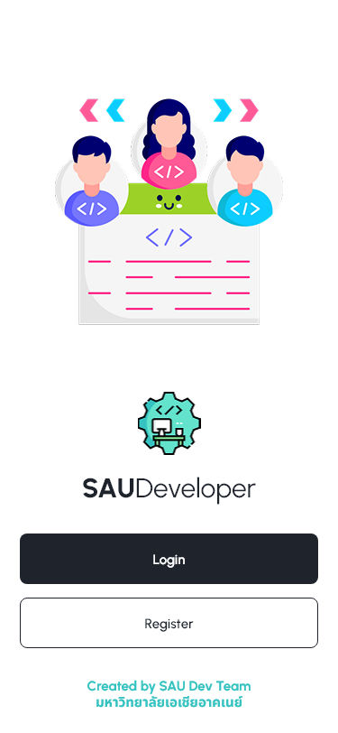
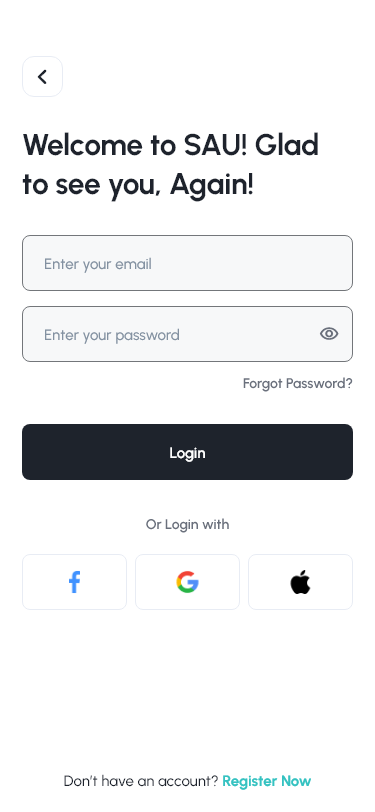

# SAU Deverloper

ต้นแบบแอปบนมือถือสำหรับสาธิตการเข้าสู่ระบบและกู้รหัสผ่าน พัฒนาด้วย Flutter และ Dart ผู้ใช้ลองกรอกข้อมูลและเดินตามขั้นตอนกู้รหัสผ่านได้ในเครื่อง โดยใช้ฟอร์มและการเปลี่ยนหน้าจอเพื่อแสดงประสบการณ์ใช้งานตามแบบ Figma

## ฟังก์ชันการทำงาน

- **Home** แสดงภาพประกอบและมีปุ่มเปิดหน้า Login
- **Login** แสดงฟอร์มอีเมลและรหัสผ่าน สลับการแสดงรหัสผ่านและเปิดหน้าลืมรหัสผ่านได้ ปุ่ม Login และปุ่ม Facebook, Google และ Apple ใช้ประกอบหน้าจอสาธิต
- **Forgot Password** ให้กรอกอีเมลและไปยังหน้ากรอก OTP ในขั้นตอนสาธิต
- **OTP Verification** ให้กรอกรหัส 4 หลักและกด Verify เพื่อไปหน้าตั้งรหัสผ่านใหม่
- **New Password** แสดงช่องกรอกรหัสผ่านใหม่ ช่องยืนยัน และปุ่ม Reset Password
- **Password Changed** แสดงข้อความสำเร็จในขั้นตอนสาธิตและมีปุ่มกลับไปหน้า Login

## ภาพหน้าจอแอปพลิเคชัน

ภาพจากแอปเวอร์ชันสุดท้ายที่ขนาด 375 × 812 logical pixels ตามเฟรม Figma

| Home | Login | Forgot Password | OTP Verification | New Password | Password Changed |
| :---: | :---: | :---: | :---: | :---: | :---: |
|  |  |  |  |  |  |

## เทคโนโลยีที่ใช้

| เทคโนโลยี / Package | หน้าที่ |
|---|---|
| Flutter และ Dart | สร้างหน้าจอ จัดการฟอร์ม และเปลี่ยนหน้าจอ |
| `material_ui` | ส่วนประกอบ Material สำหรับหน้าจอและฟอร์ม |
| `google_fonts` | ใช้ Urbanist จากไฟล์ฟอนต์ที่อยู่ในโปรเจกต์ |
| `font_awesome_flutter` | แสดงไอคอนลูกศรย้อนกลับ |
| `flutter_launcher_icons` | สร้าง Launcher Icons จากภาพต้นทางของแอป |
| `flutter_test` และ `flutter_lints` | เขียน Widget tests และกำหนดกฎวิเคราะห์โค้ด |

## โครงสร้างโปรเจกต์

| ไฟล์ใน `lib/views/` | Class | หน้าจอและหน้าที่ |
|---|---|---|
| `home_ui.dart` | `HomeUI` | Home แสดงภาพประกอบและมีปุ่มไปหน้า Login |
| `login_ui.dart` | `LoginUI` | Login แสดงฟอร์มอีเมลและรหัสผ่าน ปุ่มเปิดหรือซ่อนรหัสผ่าน และลิงก์ลืมรหัสผ่าน |
| `forgot_ui.dart` | `ForgotUI` | Forgot Password รับอีเมลเพื่อไปยังหน้ากรอก OTP ในขั้นตอนสาธิต |
| `otp_ui.dart` | `OtpUI` | OTP Verification แสดงช่องกรอกรหัส 4 หลักและปุ่ม Verify |
| `new_password_ui.dart` | `NewPasswordUI` | New Password แสดงช่องรหัสผ่านใหม่ ช่องยืนยัน และปุ่ม Reset Password |
| `password_change_ui.dart` | `PasswordChangeUI` | Password Changed แสดงข้อความสำเร็จและปุ่มกลับไป Login |

| ตำแหน่ง | เนื้อหา |
|---|---|
| `lib/main.dart` | จุดเริ่มต้นของแอปและการตั้งค่าเส้นทางหน้าจอ |
| `lib/widgets/` | Widget ที่ใช้ร่วมกันระหว่างหน้าจอ |
| `assets/images/` และ `assets/fonts/` | รูปประกอบ โลโก้ ฟอนต์ และไฟล์สิทธิ์ของฟอนต์ |
| `docs/screenshots/` | ภาพหน้าจอสำหรับ README |
| `test/` | Widget tests |
| `android/`, `ios/` และ `web/` | ไฟล์ตั้งค่าและไอคอนของแต่ละแพลตฟอร์ม |
| `pubspec.yaml` และ `pubspec.lock` | การตั้งค่า Flutter, Assets, Launcher Icons และเวอร์ชัน Dependencies |

## การติดตั้งและใช้งาน

เตรียม Flutter SDK 3.47.0 ขึ้นไปที่รองรับ Dart 3.14 และ Google Chrome
ตรวจให้แน่ใจว่าคำสั่ง `flutter` อยู่ใน PATH จากนั้นเปิด Terminal ที่โฟลเดอร์โปรเจกต์

รันคำสั่งต่อไปนี้

```sh
flutter pub get
flutter run -d chrome
```

ใช้ Device Toolbar ใน Chrome DevTools แล้วกำหนด viewport เป็น 375 × 812 เพื่อเทียบกับเฟรม Figma
หรือ 440 × 956 เพื่อตรวจเลย์เอาต์ที่ขนาด iPhone 16 Pro Max

## การทดสอบและข้อจำกัด

งานพัฒนาและ QA ผ่านการตรวจรับเดิมตามบันทึกของรายวิชา ภาพหน้าจอใน README เป็นหลักฐานจาก Flutter Web และการเทียบขนาด iPhone ใน Chrome เป็นการตรวจเลย์เอาต์เว็บ ผลทดสอบบน Android และ iOS แบบ native ยังไม่มีหลักฐานยืนยัน

Widget tests ใน `test/widget_test.dart` ตรวจเส้นทางทั้งหกหน้าจอและพฤติกรรมของฟอร์มด้วยคำสั่ง `flutter test` รอบเตรียมเอกสารนี้ใช้ผลตรวจรับเดิมและไม่ได้รัน Build หรือ Tests ซ้ำ การเข้าสู่ระบบ การกรอก OTP และการตั้งรหัสผ่านเป็นขั้นตอนสาธิตที่ทำงานในเครื่องโดยไม่มีการเชื่อมต่อระบบยืนยันตัวตน

## เครดิตและสิทธิ์การใช้งาน

### 1. ทรัพยากรจากอาจารย์และ Figma

งานนี้อ้างอิง Mockup ใน Figma และใช้ภาพกับไอคอนจาก Resources ของรายวิชา
เมื่อวันที่ 26 พฤศจิกายน 2569 อาจารย์ตอบว่า “จัดได้เลย” สำหรับการนำรูปภาพ ไอคอนจาก Figma และ Resources ที่อาจารย์ให้ขึ้น Public GitHub เพื่อส่ง Assignment
คำอนุญาตมีขอบเขตเพื่อส่งงานในรายวิชา ลิขสิทธิ์ยังเป็นของเจ้าของเดิม และการใช้ทรัพยากรของบุคคลที่สามอยู่ภายใต้เงื่อนไขของเจ้าของสิทธิ์แต่ละราย

### 2. Fonts, Packages และ Open-source Licenses

| ทรัพยากร | ผู้สร้างและสิทธิ์การใช้งาน |
|---|---|
| Urbanist | The Urbanist Project Authors ([ต้นทาง](https://github.com/coreyhu/Urbanist)) · [SIL OFL 1.1](assets/fonts/Urbanist-OFL.txt) |
| Noto Sans Thai | The Noto Project Authors ([ต้นทาง](https://github.com/notofonts/thai)) · [SIL OFL 1.1](assets/fonts/NotoSansThai-OFL.txt) |
| Flutter SDK และ `flutter_test` | The Flutter Authors · [BSD 3-Clause](https://github.com/flutter/flutter/blob/master/LICENSE) |
| `material_ui` 1.11.1 | The Flutter Authors · [BSD 3-Clause](https://pub.dev/packages/material_ui/license) |
| `google_fonts` 9.0.0 | The Flutter Authors · [BSD 3-Clause](https://pub.dev/packages/google_fonts/license) |
| `font_awesome_flutter` 11.0.0 | Brian Egan และผู้ร่วมพัฒนา · [MIT สำหรับแพ็กเกจ](https://pub.dev/packages/font_awesome_flutter/license) ส่วน [Font Awesome Free](https://fontawesome.com/license/free) ใช้ CC BY 4.0 สำหรับไอคอนและ SIL OFL 1.1 สำหรับฟอนต์ |
| `flutter_lints` 6.0.0 | The Flutter Authors · [BSD 3-Clause](https://pub.dev/packages/flutter_lints/license) |
| `flutter_launcher_icons` 0.14.4 | Mark O’Sullivan และผู้ร่วมพัฒนา · [MIT](https://pub.dev/packages/flutter_launcher_icons/license) |

เวอร์ชันของ Dependencies ทางอ้อมระบุไว้ใน `pubspec.lock` โดยมีสิทธิ์การใช้งานตามไฟล์ LICENSE ของแต่ละแพ็กเกจ

### 3. Third-party Assets และ Trademarks

โลโก้ในหน้า Login และภาพหน้าจอใช้แสดงตามแบบ UI ในรายวิชา ปุ่ม Social Login เป็นส่วนของหน้าจอสาธิต
เครื่องหมายการค้าเป็นของเจ้าของแต่ละราย การแจกจ่ายไฟล์โลโก้และภาพที่มีโลโก้บน Public GitHub ยังต้องยืนยันสิทธิ์ตามแหล่งต้นทางและเงื่อนไขที่ใช้กับงานนี้

| ไฟล์ | เจ้าของเครื่องหมายและข้อจำกัด |
|---|---|
| `img_google.png` | Google · ปุ่มแบบไอคอนอยู่ภายใต้ข้อกำหนดเรื่องอาร์ตเวิร์ก สี ขนาด และระยะห่าง ยังยืนยันแหล่งต้นทางของ PNG นี้ไม่ได้ ([Google Identity Branding Guidelines](https://developers.google.com/identity/branding-guidelines)) |
| `img_facebook.png` | Meta · ยังยืนยันแหล่งต้นทางของ PNG และเงื่อนไขสำหรับรูปตัว f ที่ใช้ใน Mockup ไม่ได้ ([Meta Brand Resources](https://about.meta.com/brand/resources/facebookapp/logo/)) |
| `img_apple.png` | Apple Inc. · Apple กำหนดให้ใช้โลโก้ตามสิทธิ์ที่ให้เป็นลายลักษณ์อักษร และกำหนดอาร์ตเวิร์กสำหรับปุ่ม Sign in with Apple แบบกำหนดเอง ยังยืนยันแหล่งต้นทางของ PNG นี้และสิทธิ์แจกจ่ายไม่ได้ ([Sign in with Apple](https://developer.apple.com/design/human-interface-guidelines/sign-in-with-apple), [Apple Trademark Guidelines](https://www.apple.com/legal/intellectual-property/guidelinesfor3rdparties.html)) |
| `img_dev1.png`, `img_dev2.png`, `img_correct.png` | ภาพประกอบ โลโก้แอป และไอคอนสถานะจากชุดทรัพยากรของงาน ยังยืนยันผู้สร้างต้นฉบับและเงื่อนไขของแต่ละภาพเพิ่มเติมไม่ได้ |

Launcher Icons ของ Android, iOS และ Web ตั้งค่าให้สร้างจาก `assets/images/img_dev2.png` สิทธิ์ของภาพต้นทางจึงใช้กับไอคอนที่สร้างจากภาพนี้ด้วย
