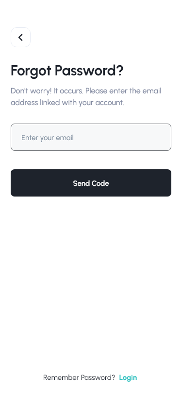
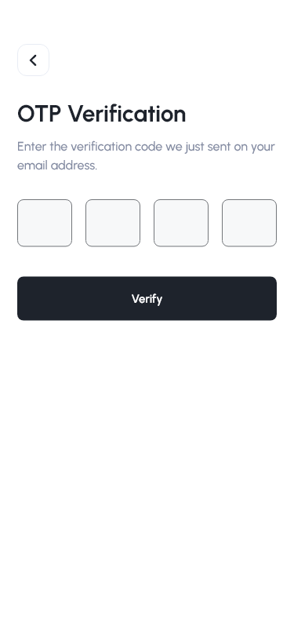
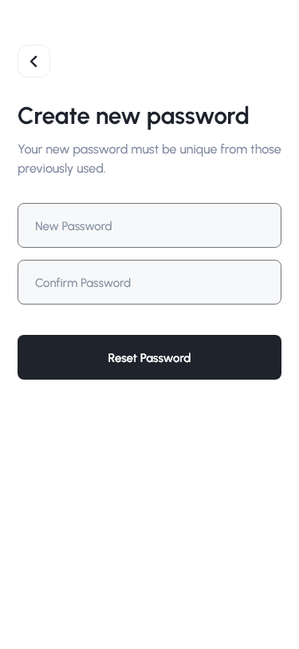
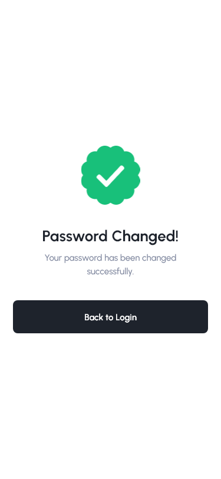

# SAU Deverloper

SAU Deverloper เป็น UI Prototype ที่พัฒนาด้วย Flutter และ Dart เพื่อสาธิตฟอร์มเข้าสู่ระบบ การกรอก OTP และการตั้งรหัสผ่านใหม่ตามแบบ Figma ทุกขั้นตอนทำงานในเครื่องและยังไม่ได้เชื่อมต่อระบบยืนยันตัวตนหรือฐานข้อมูลจริง

## ฟังก์ชันการทำงาน

- **Home** แสดงภาพประกอบและมีปุ่มเปิดหน้า Login
- **Login** แสดงฟอร์มอีเมลและรหัสผ่าน สลับการแสดงรหัสผ่านและเปิดหน้าลืมรหัสผ่านได้ ปุ่ม Login และปุ่ม Facebook, Google และ Apple ใช้ประกอบหน้าจอสาธิต
- **Forgot Password** ให้กรอกอีเมลและไปยังหน้ากรอก OTP ในขั้นตอนสาธิต
- **OTP Verification** ให้กรอกรหัส 4 หลักและกด Verify เพื่อไปหน้าตั้งรหัสผ่านใหม่
- **New Password** แสดงช่องกรอกรหัสผ่านใหม่ ช่องยืนยัน และปุ่ม Reset Password
- **Password Changed** แสดงข้อความสำเร็จในขั้นตอนสาธิตและมีปุ่มกลับไปหน้า Login

## ภาพหน้าจอแอปพลิเคชัน

ภาพจาก Flutter Web ใน Chrome ที่ขนาด 375 × 812 logical pixels ตามเฟรม Figma

| Home | Login | Forgot Password | OTP Verification | New Password | Password Changed |
| :---: | :---: | :---: | :---: | :---: | :---: |
|  |  |  |  |  |  |

## เทคโนโลยีที่ใช้

| เทคโนโลยี / Package | หน้าที่ |
|---|---|
| Flutter และ Dart | สร้างหน้าจอ จัดการฟอร์ม และเปลี่ยนหน้าจอ |
| `material_ui` | ส่วนประกอบ Material สำหรับหน้าจอและฟอร์ม |
| `google_fonts` | ใช้ Urbanist จากไฟล์ในโปรเจกต์ โดยใช้ Noto Sans Thai สำหรับข้อความภาษาไทย |
| `font_awesome_flutter` | แสดงไอคอนลูกศรย้อนกลับ |
| `flutter_launcher_icons` | สร้าง Launcher Icons จากภาพต้นทางของแอป |
| `flutter_test` และ `flutter_lints` | เขียน Widget tests และกำหนดกฎวิเคราะห์โค้ด |

## โครงสร้างโปรเจกต์

| ไฟล์ | Class | หน้าที่ |
| --- | --- | --- |
| `lib/main.dart` | `FlutterComengProject` | ตั้งธีม ฟอนต์ และเส้นทางหน้าจอ |
| `lib/views/home_ui.dart` | `HomeUI` | หน้าแนะนำก่อนเข้าสู่ Login |
| `lib/views/login_ui.dart` | `LoginUI` | ฟอร์มเข้าสู่ระบบและทางไปหน้ากู้รหัสผ่าน |
| `lib/views/forgot_ui.dart` | `ForgotUI` | ฟอร์มกรอกอีเมล |
| `lib/views/otp_ui.dart` | `OtpUI` | ฟอร์มกรอก OTP |
| `lib/views/new_password_ui.dart` | `NewPasswordUI` | ฟอร์มตั้งรหัสผ่านใหม่ |
| `lib/views/password_change_ui.dart` | `PasswordChangeUI` | หน้ายืนยันผลในขั้นตอนสาธิต |
| `lib/widgets/screen_widgets.dart` | `ScreenLayout`, `FormHeader`, `PrimaryButton` | ส่วนประกอบที่ใช้ร่วมกันระหว่างหน้าจอ |
| `assets/images/`, `assets/fonts/` | — | รูปประกอบ โลโก้ ฟอนต์ และไฟล์สัญญาอนุญาต |

## การติดตั้งและใช้งาน

ใช้ Flutter SDK 3.47.0 ขึ้นไปตาม `pubspec.lock` ที่รองรับ Dart `^3.14.0` ตาม `pubspec.yaml` ติดตั้ง Chrome แล้วรันคำสั่งจากโฟลเดอร์โปรเจกต์

```sh
flutter pub get
flutter run -d chrome
```

ใช้ Device Toolbar ใน Chrome DevTools แล้วกำหนด viewport เป็น 375 × 812 เพื่อเทียบกับเฟรม Figma
หรือ 440 × 956 เพื่อตรวจเลย์เอาต์ที่ขนาด iPhone 16 Pro Max

## การทดสอบและข้อจำกัด

- ตรวจเลย์เอาต์บน Flutter Web ใน Chrome ผลรันแอปแบบ native บน Android และ iOS ยังไม่ได้ยืนยัน
- [Widget tests](test/widget_test.dart) ครอบคลุมเส้นทางทั้งหกหน้า การแสดงหรือซ่อนรหัสผ่าน และการกรอก OTP
- การเข้าสู่ระบบ การยืนยัน OTP และการตั้งรหัสผ่านใหม่เป็นขั้นตอนสาธิต แอปยังไม่มี Backend สำหรับตรวจบัญชี ส่งรหัส หรือบันทึกรหัสผ่าน และยังไม่ได้เชื่อมต่อผู้ให้บริการ Social Login

## เครดิตและสิทธิ์การใช้งาน

### 1. ทรัพยากรจากอาจารย์และ Figma

หน้าจออ้างอิง Mockup ใน Figma และใช้ภาพกับไอคอนจาก Resources ของรายวิชา

### 2. Fonts, Packages และ Open-source Licenses

| ทรัพยากร | ผู้สร้างและสิทธิ์การใช้งาน |
|---|---|
| Urbanist | The Urbanist Project Authors ([ต้นทาง](https://github.com/coreyhu/Urbanist)) · [SIL OFL 1.1](assets/fonts/Urbanist-OFL.txt) |
| Noto Sans Thai | The Noto Project Authors ([ต้นทาง](https://github.com/notofonts/thai)) · [SIL OFL 1.1](assets/fonts/NotoSansThai-OFL.txt) |
| Flutter SDK และ `flutter_test` | The Flutter Authors · [BSD 3-Clause](https://github.com/flutter/flutter/blob/master/LICENSE) |
| `material_ui` 1.11.1 | The Flutter Authors · [BSD 3-Clause](https://pub.dev/packages/material_ui/license) |
| `google_fonts` 9.0.0 | The Flutter Authors · [BSD 3-Clause](https://pub.dev/packages/google_fonts/license) |
| `font_awesome_flutter` 11.0.0 | Brian Egan และผู้ร่วมพัฒนา · [MIT สำหรับแพ็กเกจ](https://pub.dev/packages/font_awesome_flutter/license) ส่วน [Font Awesome Free](https://fontawesome.com/license/free) ใช้ CC BY 4.0 สำหรับไอคอนและ SIL OFL 1.1 สำหรับฟอนต์ |
| `flutter_lints` 6.0.0 | The Flutter Authors · [BSD 3-Clause](https://pub.dev/packages/flutter_lints/license) |
| `flutter_launcher_icons` 0.14.4 | Mark O’Sullivan และผู้ร่วมพัฒนา · [MIT](https://pub.dev/packages/flutter_launcher_icons/license) |

เวอร์ชันของ Dependencies ทางอ้อมระบุไว้ใน `pubspec.lock` โดยมีสิทธิ์การใช้งานตามไฟล์ LICENSE ของแต่ละแพ็กเกจ

### 3. Third-party Assets และ Trademarks

โลโก้และภาพประกอบใช้ในหน้าจอสาธิตเพื่อการศึกษา เครื่องหมายการค้าเป็นของเจ้าของแต่ละราย สิทธิ์เผยแพร่ซ้ำของไฟล์โลโก้และภาพหน้าจอที่มีโลโก้ยังไม่ได้รับการยืนยัน

| ไฟล์ | เจ้าของเครื่องหมายและข้อจำกัด |
|---|---|
| `img_google.png` | Google · ปุ่มแบบไอคอนอยู่ภายใต้ข้อกำหนดเรื่องอาร์ตเวิร์ก สี ขนาด และระยะห่าง ยังยืนยันแหล่งต้นทางของ PNG นี้ไม่ได้ ([Google Identity Branding Guidelines](https://developers.google.com/identity/branding-guidelines)) |
| `img_facebook.png` | Meta · ยังยืนยันแหล่งต้นทางของ PNG และเงื่อนไขสำหรับรูปตัว f ที่ใช้ใน Mockup ไม่ได้ ([Meta Brand Resources](https://about.meta.com/brand/resources/facebookapp/logo/)) |
| `img_apple.png` | Apple Inc. · Apple กำหนดให้ใช้โลโก้ตามสิทธิ์ที่ให้เป็นลายลักษณ์อักษร และกำหนดอาร์ตเวิร์กสำหรับปุ่ม Sign in with Apple แบบกำหนดเอง ยังยืนยันแหล่งต้นทางของ PNG นี้และสิทธิ์แจกจ่ายไม่ได้ ([Sign in with Apple](https://developer.apple.com/design/human-interface-guidelines/sign-in-with-apple), [Apple Trademark Guidelines](https://www.apple.com/legal/intellectual-property/guidelinesfor3rdparties.html)) |
| `img_dev1.png`, `img_dev2.png`, `img_correct.png` | ภาพประกอบ โลโก้แอป และไอคอนสถานะจากชุดทรัพยากรของงาน ยังยืนยันผู้สร้างต้นฉบับและเงื่อนไขของแต่ละภาพเพิ่มเติมไม่ได้ |

Launcher Icons ของ Android, iOS และ Web ตั้งค่าให้สร้างจาก `assets/images/img_dev2.png` สิทธิ์ของภาพต้นทางจึงใช้กับไอคอนที่สร้างจากภาพนี้ด้วย
